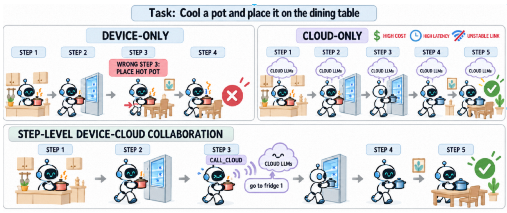
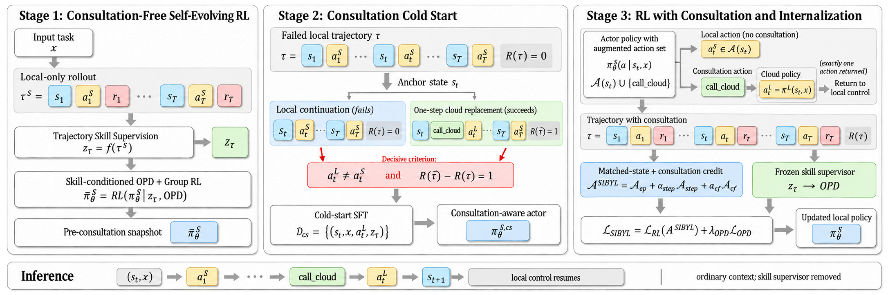

<p align="center">
  
  &nbsp;&nbsp;
  
</p>

<p align="center">
  <b>An Efficient Small-Large Model Collaboration Framework for Long-Horizon Tasks</b>
</p>

<p align="center">
  <a href="https://arxiv.org/abs/2610.05383">Paper</a>
  &nbsp;·&nbsp; Inference code: ready
  &nbsp;·&nbsp; Models: coming soon
</p>

The local agent chooses `call_cloud` when it needs help. The cloud supplies one action, then the local agent continues.

<p align="center">
  
</p>

## Method

Paper overview; this release contains ALFWorld inference only.

<p align="center">
  
</p>

## Quick start

**ALFWorld · Python 3.10+ · CUDA.** Use a compatible Sibyl actor checkpoint; public weights are coming soon.

```bash
python -m pip install -e '<SOURCE_DIR>'
python -m sibyl_inference.prepare_tokenizer --model '<MODEL_DIR>'

export SIBYL_CLOUD_API_KEY='<API_KEY>'
python -m sibyl_inference.infer \
  --model '<MODEL_DIR>' \
  --input '<INPUT_JSONL>' \
  --cloud-base-url 'https://<CLOUD_HOST>/v1' \
  --cloud-model '<CLOUD_MODEL>'
```

<details>
<summary>Input format</summary>

One state per JSONL line:

```json
{
  "task": "put a pencil in shelf.",
  "observation": "You arrive at desk 1. On desk 1, you see a pencil 1. Your task is to: put a pencil in shelf.",
  "admissible_actions": ["take pencil 1 from desk 1", "go to shelf 1", "look"],
  "history": []
}
```

Supply past `observation`, `action`, and `result` entries in `history`. The caller executes `executed_action` and updates history. Check validity and errors first.

For delegated steps, record `<executed action> [chosen by cloud]` in actor history, and `call_cloud -> <executed action>` in the optional `cloud_history`.

The actor uses the latest 5 history entries, with input/output limits of 2048/512 tokens. The cloud sees the full history and `inventory` when supplied. Failed or invalid decisions return `executed_action: null`.

</details>

<details>
<summary>Local inference without cloud</summary>

```bash
python -m sibyl_inference.infer --model '<MODEL_DIR>' --input '<INPUT_JSONL>'
```

A `call_cloud` request remains unresolved (`executed_action: null`).

</details>

<details>
<summary>Citation</summary>

```bibtex
@misc{fang2026sibyl,
  title={Sibyl: An Efficient Small-Large Model Collaboration Framework for Long-Horizon Tasks},
  author={Zhewei Fang and Yuxin Zhang and Zhenwei Shao and Mengze Li and Zheng Lin and Long Chen and Zhou Yu and Zhe Chen and Zhiwen Chen and Zhaode Wang and Chengfei Lv},
  year={2026},
  eprint={2610.05383},
  archivePrefix={arXiv},
  primaryClass={cs.AI}
}
```

</details>

Code: Apache-2.0. Built on [verl-agent](https://github.com/langfengQ/verl-agent) and [veRL](https://github.com/volcengine/verl).
